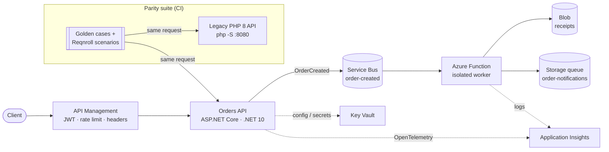

# Legacy PHP API → .NET 10 on Azure, tested end to end (Demo)

[](https://github.com/ShipSureQA/azure-dotnet-migration/actions/workflows/ci.yml) [](https://github.com/ShipSureQA/azure-dotnet-migration/actions/workflows/codeql.yml) [](https://shipsureqa.github.io/azure-dotnet-migration/) [](docs/UPGRADE.md) [](LICENSE)

**Live test report (updated on every run of `main`):** https://shipsureqa.github.io/azure-dotnet-migration/

> **Self-initiated demo, not client work.** I built this project to show how I test a migration. The "legacy"
> PHP API, its data and the Azure set-up are all made up for the demo. No client code or data is used, and nothing
> is deployed to Azure.

A small legacy PHP 8 REST API (customers and orders) is ported to an ASP.NET Core minimal API, upgraded from
**.NET 8 to .NET 10**, and connected to **Azure services that all run on free local emulators**. Tests prove at
each step that behaviour did not change.

## What it demonstrates

### 1. PHP → .NET migration with parity testing
- `legacy-php/`: plain PHP 8, no framework, runs with `php -S`. This is the "before".
- `src/Orders.Api`: the .NET port with the same routes, status codes, JSON and error messages.
- **Parity suite** (`tests/Orders.ParityTests`) runs both APIs side by side and sends them identical requests:
  - **36 golden/contract cases**: legacy == .NET == golden file recorded from PHP (status, `Content-Type`,
    `Location`, JSON shape and values);
  - **Reqnroll BDD feature** (SpecFlow successor): tier discounts, order lifecycle, invalid transitions, validation;
  - **intentional differences pinned by tests** (strict typing, no `X-Powered-By`). See [docs/MIGRATION.md](docs/MIGRATION.md).
- **A real defect it caught:** PHP `round()` rounds half away from zero; .NET `Math.Round` rounds half to even.
  2.665 became 2.66 instead of 2.67 in the first port. Fixed with `MidpointRounding.AwayFromZero` and pinned by tests.

### 2. Upgrade path net8.0 → net10.0
- Step-by-step guide: [docs/UPGRADE.md](docs/UPGRADE.md) (`global.json`, target framework, central package
  versions per framework, breaking-change checks, analyzer warnings, drop plan).
- The code **multi-targets `net8.0;net10.0`** and the **CI matrix runs every suite on both runtimes**, including the
  black-box parity suite against the API running on each. Same tests, both green = same behaviour.
- Package versions verified on nuget.org (ASP.NET Core 10.0.15 / 8.0.34, Azure SDK, Functions Worker 2.x,
  Reqnroll 3.3, xUnit 2.9).

### 3. Azure integration without a subscription
| Azure service | Local / CI stand-in | Details |
|---|---|---|
| Service Bus (`order-created` queue) | Official Service Bus emulator (Docker) | Best-effort CI job; in-memory transport by default |
| Azure Functions, isolated worker (.NET 10) | Handler run by tests against emulators | Receipt blob + notification message, idempotent |
| Storage Queues + Blob | Azurite (Docker) | Runs in the main CI job |
| Key Vault | `IConfiguration` abstraction, fake provider in tests | `DefaultAzureCredential` path documented |
| Application Insights | OpenTelemetry, exported only if a connection string is set | Span + metric verified by a test |
| API Management | Policy XML validated by tests | Rate limit, JWT validation, header policies |
| Infrastructure as code | `infra/main.bicep` compiled in CI | **Not deployed** |

Details: [docs/AZURE.md](docs/AZURE.md)

## Architecture



Locally and in CI: Service Bus = emulator or in-memory, Storage = Azurite, Key Vault = configuration providers,
Application Insights = OpenTelemetry without exporter, APIM = policy validation.

## Run it locally

Requirements: .NET 10 SDK (plus the .NET 8 runtime for the `net8.0` target), PHP 8.x, Docker.

```bash
# 1. Emulators (Azurite) - optional: add the Service Bus emulator, see docs/AZURE.md
docker compose up -d azurite

# 2. Build and run unit + integration tests
dotnet build AzureDotnetMigration.slnx
dotnet test tests/Orders.UnitTests
dotnet test tests/Orders.IntegrationTests --filter "Category!=ServiceBusEmulator"
#   no Docker? add: --filter "Category!=ServiceBusEmulator&Category!=Azurite"

# 3. Start both APIs (two terminals)
ENABLE_TEST_ENDPOINTS=true php -S 127.0.0.1:8080 legacy-php/public/index.php
dotnet run --project src/Orders.Api -f net10.0      # http://127.0.0.1:5080, test endpoints on in Development

# 4. Parity suite (golden contracts + Reqnroll BDD)
dotnet test tests/Orders.ParityTests

# 5. Optional: HTML report like the one on GitHub Pages
dotnet test --logger "trx;LogFileName=unit-net10.0.trx" --results-directory TestResults tests/Orders.UnitTests -f net10.0
python3 tools/trx_to_html.py TestResults site && open site/index.html
```
The legacy API can also run in Docker: `docker compose up -d legacy-php`.

Try it:
```bash
curl -s localhost:5080/api/orders?customerId=1
curl -s -X POST localhost:5080/api/orders -H 'Content-Type: application/json' \
     -d '{"customerId":2,"lines":[{"sku":"MS-777","quantity":2,"unitPrice":26.65}]}'
```

## Tests

| Suite | Project | What | Runs on |
|---|---|---|---|
| Unit | `Orders.UnitTests` | Pricing and rounding, validation, order state machine, Function handler with fakes, messaging and Key Vault configuration, APIM policy XML, emulator config | net8.0 + net10.0 |
| Integration | `Orders.IntegrationTests` | In-process API (`WebApplicationFactory`), telemetry span, messaging outage, Azurite Blob/Queue, API → queue → Function logic end to end | net8.0 + net10.0 |
| Service Bus | `Orders.IntegrationTests` (`Category=ServiceBusEmulator`) | Service Bus emulator → Function logic → Azurite | net10.0, best-effort job |
| Parity | `Orders.ParityTests` | 36 golden cases + Reqnroll feature, legacy PHP vs running .NET API | API on net8.0 + net10.0 |

## CI / quality gates
GitHub Actions ([ci.yml](.github/workflows/ci.yml)) on every push, pull request and weekly:
- **Build & test matrix** `net8.0` / `net10.0`: build (incl. Functions), unit, integration with Azurite,
  then start PHP + .NET APIs and run the parity suite
- **Service Bus emulator** job (best effort, does not block)
- **Bicep build** and APIM policy XML check
- **HTML test report** from all TRX files, published to [GitHub Pages](https://shipsureqa.github.io/azure-dotnet-migration/)
- **CodeQL** for C# and GitHub Actions; **Dependabot** for NuGet (central package versions) and GitHub Actions

## Structure
```
legacy-php/          Legacy PHP 8 API (before)
data/seed.json       Seed data shared by both APIs
src/Orders.Core      Domain: pricing, validation, store (port of the PHP logic)
src/Orders.Api       ASP.NET Core minimal API (after), OpenTelemetry, Key Vault config
src/Orders.Messaging Service Bus / Storage publishers, receipt handler, Key Vault secret mapping
src/Orders.Functions Azure Functions isolated worker (Service Bus trigger)
tests/               Unit, integration and parity (golden + Reqnroll) tests
infra/               Bicep (not deployed), APIM policy, Service Bus emulator config
tools/               Golden recorder, TRX → HTML report
docs/                MIGRATION.md, UPGRADE.md, AZURE.md
```

## Author
**Nagarasu P · [ShipSure QA](https://shipsureqa.github.io)**. Senior QA automation engineer, available for freelance projects.

## License
[MIT](LICENSE)
